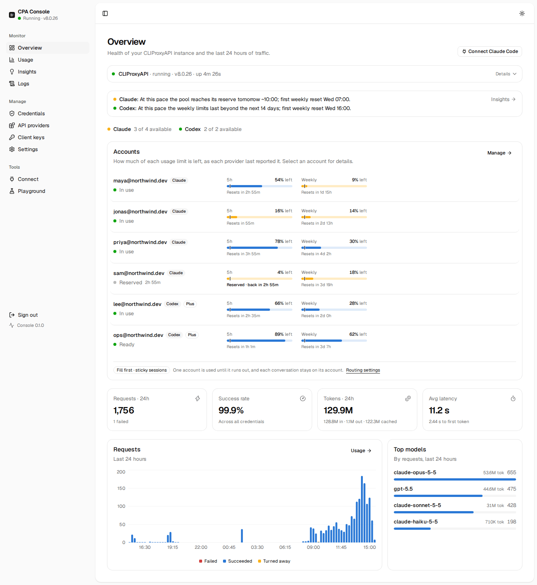
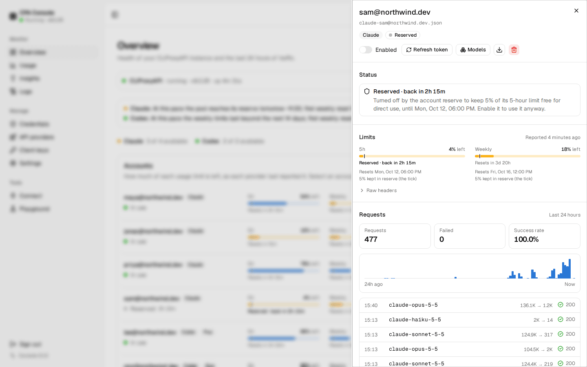
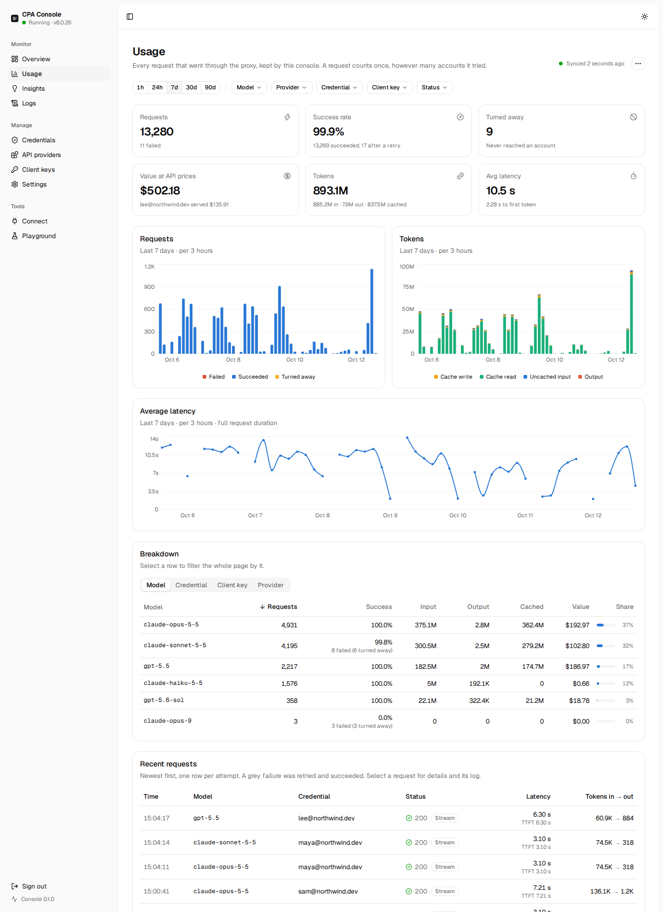
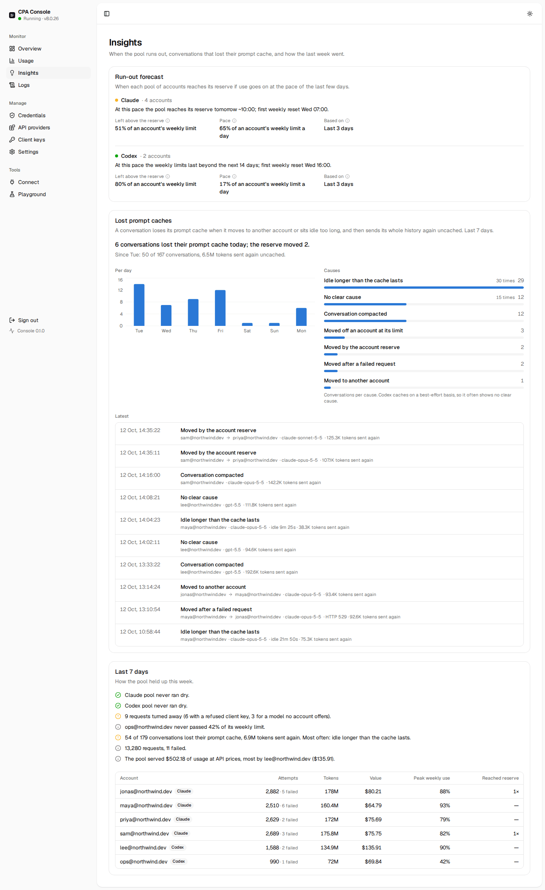
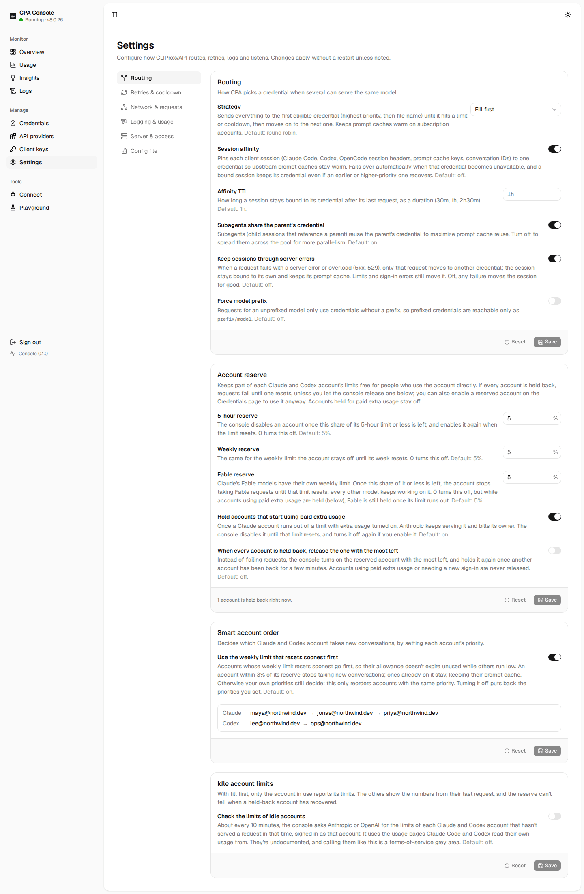
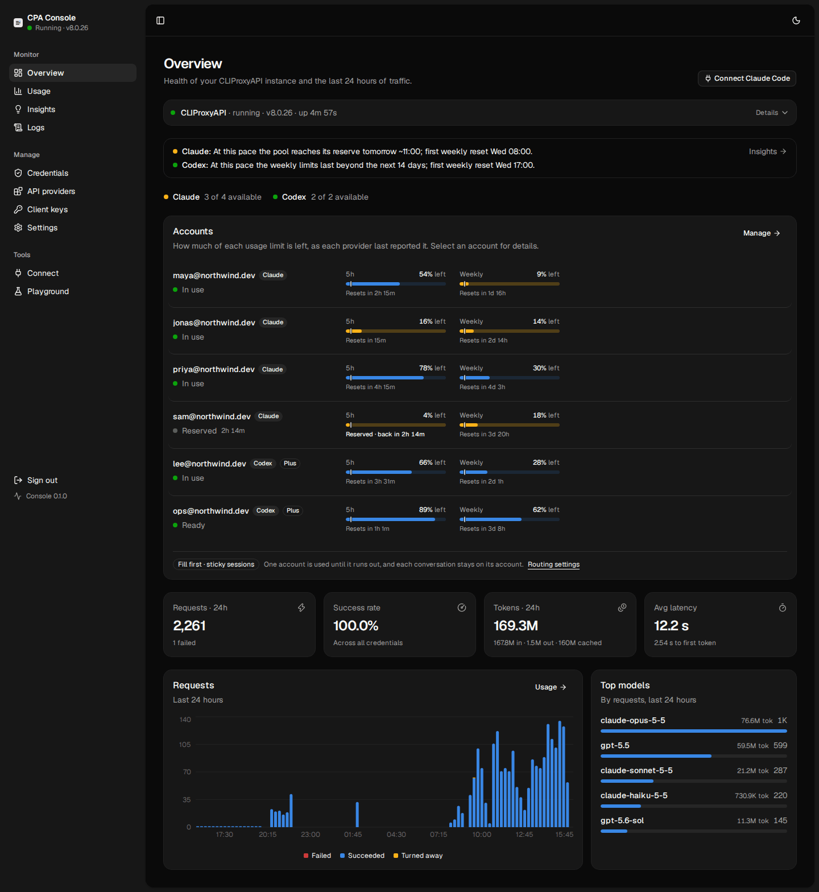
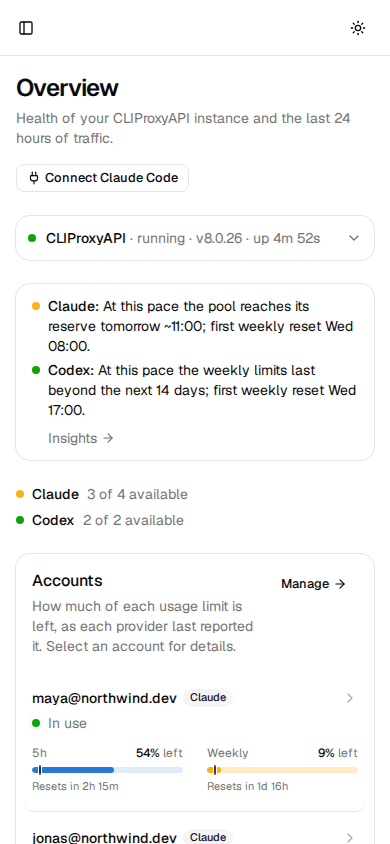

# CPA Console

A self-contained web console for [CLIProxyAPI](https://github.com/router-for-me/CLIProxyAPI). One command downloads
CPA, runs it as a supervised process and gives you a polished UI to manage it. You don't install CPA separately.

- **Process management**: installs the latest CPA release for your platform (checksum-verified), restarts it if it
  crashes or stops answering, and updates it in one click. `/console/health` is there for uptime monitors.
- **Usage analytics**: CPA only keeps per-request usage for a few minutes. The console drains it continuously into
  SQLite, so you get history by model, credential, client key and provider, with tokens, latency, failures, requests
  turned away before reaching an account, and what the traffic would have cost at API prices.
- **Accounts at a glance**: every Claude and Codex account with its 5-hour, weekly and Fable limits, how much of each is left
  and when it resets. A reserve (5% by default) turns an account off before its limit runs out and back on when it resets,
  so people who use the account directly keep some room. Accounts that start billing paid extra usage are held too, and
  signed-out accounts are taken out of rotation until you sign them in again.
- **Smart account order**: with fill first, among accounts of the same priority, the one whose weekly limit resets soonest is used first, and
  accounts close to their reserve stop taking new conversations while ongoing ones keep their prompt cache.
- **Insights**: when each pool will reach its reserve at the current pace, which conversations lost their prompt cache
  and why, and a plain summary of the last 7 days.
- **Credentials**: Claude and Codex sign-in, file uploads, enable/disable, cooldowns, per-credential traffic and bulk actions.
- **API providers & client keys**: structured editors instead of raw YAML.
- **Settings**: documented forms for routing, retries, networking and logging, plus a YAML editor with diff review.
- **Logs**: live log tail, CPA process output, and request and error logs.

## Preview



<table>
  <tr>
    <td width="50%"><a href="docs/screenshots/account-panel.png"></a><br>An account's panel: why it is held back, its limits and its last 24 hours.</td>
    <td width="50%"><a href="docs/screenshots/usage.png"></a><br>Usage: requests, tokens, latency and value at API prices, by model, account and client key.</td>
  </tr>
  <tr>
    <td><a href="docs/screenshots/insights.png"></a><br>Insights: when the pool runs out, conversations that lost their prompt cache, and the last 7 days.</td>
    <td><a href="docs/screenshots/settings-routing.png"></a><br>Settings → Routing: strategy, sticky sessions, the account reserve and smart account order.</td>
  </tr>
  <tr>
    <td><a href="docs/screenshots/overview-dark.png"></a><br>Dark mode.</td>
    <td><a href="docs/screenshots/overview-phone.png"></a><br>On a phone.</td>
  </tr>
</table>

The screenshots show a demo setup with made-up accounts and traffic.

## Quick start

Requires Node.js 22.13 or newer.

```sh
npx cliproxyui
```

The console prints a setup link (and opens it if it can). Open it and pick the proxy port. The management key is
pre-generated, so save it, then click **Start CLIProxyAPI**. CPA is already downloading in the background while you
fill in the form.

Clients then connect straight to CPA, e.g. `http://<server>:8317/v1`, using the client key shown on the Overview page.
The Connect page has ready-to-run setup for Claude Code, Codex and other clients, with the address and key of your choice
filled in, and checks from your browser that both work.

### Keep it running

```sh
npx cliproxyui service install
```

This installs a background service that starts at boot: systemd on Linux (a user service, or a system service when
run as root) and launchd on macOS. It installs the latest nightly into the data directory, so it never depends on the
npx cache. `service status` and `service uninstall` do what you'd expect; uninstalling keeps your data.

The console restarts CLIProxyAPI when it exits, and also when it is still running but has stopped answering for about a
minute. The Overview page says when that happened.

For an uptime monitor such as Uptime Kuma, use `GET /console/health` (for example `http://your-host:8320/console/health`).
It needs no key and returns only states, times, counts and the console version, never keys, paths or account names:

- `200` with `"status": "ok"` when CLIProxyAPI is running and answered its last check (every 15 seconds).
- `503` otherwise, with `status` saying why: `stopped` (stopped from the console), `starting`, `stopping`, `crashed`,
  `unresponsive`, `not-installed` or `not-set-up`.

`usage.stale` turns `true` when request records have not been collected for 10 minutes while CLIProxyAPI runs.
CLIProxyAPI drops records it holds for more than an hour, so act on it before then. In Uptime Kuma, an HTTP(s) monitor
alerts on the status code (set retries to 1, so one slow check doesn't alert); to also alert on stale usage, use an **HTTP(s) - Json Query** monitor with the query
`status = "ok" and usage.stale = false` and expected value `true`.

### Updating

The console is a rolling nightly: every merge to `main` publishes a new build to npm under the default `latest` tag.
When a newer build exists, the console's sidebar shows **Update available** with the exact command, including any
`--data`, `--port` or `--host` options the console runs with. For a service, that re-runs `service install`, which
reinstalls the latest nightly and keeps your data. For a foreground run, stop the console and run the npx command
again; npx fetches the new build. CLIProxyAPI itself updates from the Overview page.

### Options

```
cliproxyui [start] [--port 8320] [--host 0.0.0.0] [--data ~/.cpa-console] [--no-open]
cliproxyui service install|uninstall|status [same options]
```

| Flag | Env | Default | |
| --- | --- | --- | --- |
| `--port` | `PORT` | `8320` | Console port |
| `--host` | `HOST` | `0.0.0.0` | Bind address. Use `127.0.0.1` behind a reverse proxy or SSH tunnel |
| `--data` | `CPA_CONSOLE_DATA` | `~/.cpa-console` | CPA binary, `config.yaml`, auth files, logs, usage database |
| | `TRUST_PROXY` | | Set to `1` behind a reverse proxy, so failed-login limits apply per client (from `X-Forwarded-For`) |
| | `USAGE_RETENTION_DAYS` | `90` | How long request history is kept |
| | `GITHUB_TOKEN` | | Optional; avoids GitHub API rate limits when checking for CPA releases |

## Security notes

- The setup link contains a one-time token. Until setup is done, anyone with the link can claim the instance, so
  finish setup right away.
- The console serves plain HTTP. To reach it over the internet, put it behind a TLS-terminating reverse proxy
  (Caddy, nginx), with `HOST=127.0.0.1` and `TRUST_PROXY=1`, or use an SSH tunnel.
- Five wrong keys from one address lock that address out for 15 minutes.
- The console checks the management key itself before forwarding anything to CPA. CPA's remote management stays
  disabled, because the console reaches it over localhost.

## Development

```sh
pnpm install          # also builds, via `prepare`
CPA_CONSOLE_DATA=/tmp/cpa-dev pnpm dev
```

`pnpm dev` runs the console server on `:8320` in watch mode and Vite on `:5173`. Open the Vite URL; the setup link
printed by the server works there too if you change its port to 5173.

Stack: Vite, React 19, TanStack Router / Query / Table, shadcn/ui (Radix, Tailwind v4) and Recharts; the server is
Hono on Node, with `node:sqlite` for usage history.

## License

MIT
